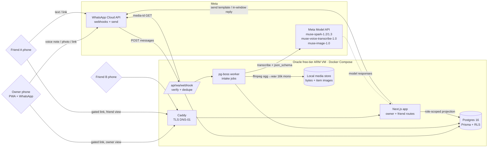

# Architecture Overview

**Status:** current as of 2026-10-26 (planning lock). Update with skill `repo-architecture` when structure changes.
Complementary: `MISTAKES.md`, `WISHLIST.md`, `SPEC.md`, `docs/plans/PLANS_INDEX.md`.

**Product in one line:** a gift-target owner shares one gated link into their own WhatsApp group; friends claim
items or pool money behind one assigned buyer, and the owner provably cannot see claims, pools, secret suggestions
or better prices.

## 1. Project Structure

```text
gifts-registry/
  AGENTS.md CLAUDE.md ARCHITECTURE.md MISTAKES.md WISHLIST.md SPEC.md
  .env                    # non-secret config only (Notion root page id, DOC_SYNC_TARGET)
  .github/workflows/      # sync-notion-docs.yml, plans-registry-gate.yml, + CI test gate
  docker-compose.yml      # app + postgres + caddy (identical local and on the Oracle VM)
  src/
    app/                  # Next.js App Router. Built: health/, c/[slug]/ (thin adapter).
                          #   Planned: (owner)/, (friend)/, api/, landing page at /
    lib/                  # env contract (zod, fails at boot), money formatting
    server/
      db/                 # client.ts (withActor — the only door), policies.ts, policy SQL
      auth/               # phone-hash.ts (keyed E.164 hash), session.ts (signed cookie)
      routes/             # framework-free route logic; circle.ts is the /c/<slug> role split
      views/              # role-scoped projection builders (the privacy boundary)
      entitlements.ts     # can() / assertCan() — the single gate on every model-spending path
      wa/                 # PLANNED: WhatsApp Cloud API client + webhook handler + media store
      models/             # PLANNED: Meta Model API client — spark, transcribe, image, sam
      intake/             # PLANNED: dedupe -> fetch media -> convert -> parse -> draft item
      ledger/             # PLANNED: circles, members, items, claims, pools, contributions
      agent/              # PLANNED: role-specific toolsets + context builder
    generated/prisma/     # generated client; gitignored
  tests/                  # leak/ (RLS), views/ (projections), entitlements/ (gate), routes/
                          #   (HTTP layer). `pnpm leak` runs all four; globalSetup applies the
                          #   migrations and the policies to DATABASE_URL_TEST every run.
  worker/                 # PLANNED: pg-boss consumer for ingest jobs
  fixtures/               # PLANNED: hand-checked SA retailer product fixtures + SOURCES.md
  scripts/                # seed.ts (fictional cast), apply_policies.ts
  scripts/ops/            # sync_docs_to_notion.py, plans registry tooling
  docs/                   # strategy / plans / investigations / operations / deployment
```

A row marked PLANNED is a module that does not exist yet. It stays in this map because the shape
is agreed, and it loses the marker the day the directory appears — a map that cannot tell you
which half is real is a map that becomes a lie.

## 2. High-Level System Diagram



**The two projections** are the diagram's point. Owner and friend traffic reaches the *same* app and the *same*
Postgres, but through different view builders, and RLS denies the owner's role any read of `claims`, `pools` or
`pool_contributions`. There is no second database.

## 3. Core Components

| Component | Responsibility | Key decision |
|---|---|---|
| `wa/webhook` | Verify `hub.challenge`, validate signature, dedupe on WhatsApp message id, enqueue | Idempotent by unique message id — Meta redelivers |
| `intake` | Normalise audio/image/text/url into a **draft** item | Drafts require human confirm; never auto-commit a model-guessed price |
| `models` | Single client for `POST /v1/responses`, `/v1/chat/completions`, `/v1/asr/transcribe` | `json_schema` output must be **flat** — recursive schemas return HTTP 400 |
| `ledger` | Items, claims, pools, contributions, tombstones | Append-only `ledger_events` gives the friend side a provable history |
| `views` | Build owner vs friend projection from one ledger | Only place that knows which columns a role may see |
| `agent` | Role-specific toolsets + context builder | The model is never *handed* data the requester cannot see |

## 4. Data Stores

Postgres 16 is the only system of record. `minor` integer amounts + explicit `currency` (ZAR) everywhere —
no floats for money.

```text
users              id, bsuid NULL, phone_e164 NULL, display_name, created_at
                   UNIQUE(bsuid), UNIQUE(phone_e164), CHECK (bsuid IS NOT NULL OR phone_e164 IS NOT NULL)
attributes         id, user_id FK (the gift target), kind, value_text, unit,
                   visibility friends|private, updated_at
                   kind ∈ ring_size, shoe_size, top, bottom, colour, other — owner-authored
circles            id, name, occasion, event_date, owner_user_id FK, share_slug UNIQUE, status
allowlist_entries  id, circle_id, phone_e164_hash, added_by, status pending|accepted|removed
memberships        id, circle_id, user_id, role owner|friend, status, joined_at
items              id, circle_id, title, canonical_url, retailer, price_minor, currency,
                   image_path, added_by_user_id,
                   visibility owner_visible|friend_only,        -- friend_only = secret suggestion
                   status active|tombstoned|revealed,
                   tombstone_reason bought_self|no_longer_wants|duplicate NULL,
                   confirmed bool, created_at, tombstoned_at
claims             id, item_id, user_id, pool_id NULL, kind solo|pool_member,
                   status claimed|fulfilled|released, created_at
pools              id, item_id, buyer_user_id, target_minor, currency,
                   status open|funded|purchased|pivot_needed
contributions      id, pool_id, user_id, amount_minor, currency,
                   status promised|marked_paid|settled, paid_at, note
ingest_events      id, wa_message_id UNIQUE, circle_id, user_id, kind audio|image|text|url,
                   media_path, media_expires_at, model_used, draft jsonb, item_id NULL,
                   status received|converted|transcribed|parsed|confirmed|failed, error
ledger_events      id, circle_id, entity, entity_id, actor_user_id, action, payload jsonb, created_at
card_entries       id, item_id, contributor_user_id FK, display_name_shown, anonymous bool,
                   message text CHECK (char_length(message) <= 200), created_at
                   -- one row per gift-giver; the card is composed from these, never stored as one blob
gift_cards         id, item_id UNIQUE, pun, tagline, model_used, art_path NULL, art_prompt,
                   rendered_png_path, rendered_at, created_by_user_id
```

**`card_entries` / `gift_cards` are friend-scoped in full.** No read policy exists for `app_owned`, so an owner
query returns zero rows and the route 404s rather than 403s — a 403 would confirm a card exists, which is the leak.
Card rows are derived state, not ledger state: deleting a card never touches `contributions`, and a tombstoned item
with a funded pool still renders its card, because the keepsake belongs to the gifters.
`message` is the gifters' own words — stored verbatim, never rewritten by a model, URLs rejected on write so the
card cannot become a channel that smuggles a retailer or a cheaper price to the owner.

**Stripe-Connect-proofing without holding money:** `contributions` already separates `promised` from `paid` from
`settled` and carries `amount_minor`/`currency`. Adding escrow later means adding a `payment_intent_id` column and
a provider, not re-shaping the ledger — which is the requirement the brief set.

**RLS (the privacy mechanism).** Policies are owned by the app role, and the request sets
`SET LOCAL ROLE app_owned | app_friend` per transaction:

```sql
ALTER TABLE claims             ENABLE ROW LEVEL SECURITY;
CREATE POLICY claims_friend_read ON claims
  FOR SELECT USING (current_setting('app.role') = 'friend');
-- no policy for owner => SELECT returns 0 rows, not an error. Same on pools, contributions.

CREATE POLICY items_owner_read ON items
  FOR SELECT USING (circle_id = current_setting('app.circle_id')::uuid
                    AND visibility = 'owner_visible');
```

Tombstoned items stay readable to friends (`status = 'tombstoned'`) and vanish from the owner view — which is
exactly the "soft delete, ledger survives" rule, expressed as a policy rather than as app-layer discipline.

## 5. External Integrations

| Surface | Used for | Called from | Constraint |
|---|---|---|---|
| WhatsApp Cloud API | inbound intake, outbound replies/templates | server webhook + send client | inbound free; media URL lives 5 min; **webhook media id expires 7 days** |
| Authentication template | optional OTP upgrade | server | **always charged** for +27; ≤24 h approval |
| `muse-spark-1.2` | audio + image → structured item | worker | 1.3 audio is documented **degraded** — 1.2 for voice |
| `muse-spark-1.3` | text-only reasoning (item merge, captions) | app | richer text, worse audio |
| `muse-voice-transcribe-1.0` | ASR path | worker | **RIFF/WAVE mono 16-bit 16/24 kHz only** → ffmpeg |
| `muse-image-1.0` | optional item imagery | app | 150 RPM team-wide |
| `web_search` grounding | deal-finding (deferred spike) | app | returns cited prose, not product records; ZA availability unconfirmed |
| Retailer page fetch | link expansion `og:*` + JSON-LD | worker | user-directed URL, our own fetch — not Meta data |
| Cloudflare DNS | TLS-01 for Caddy | deploy | token from vault, never committed |

Explicitly **not** used: Facebook Marketplace (prohibited by Meta's Automated Data Collection terms; would breach
two disqualification rules), the WhatsApp Groups API (Official-Business-Account gated, 8 participants, cannot post
into a user's existing group), Facebook Login.

## 6. Deployment & Infrastructure

Oracle Always Free Ampere VM, `docker compose` under Caddy. Chosen over Vercel+Neon and Cloud Run because this
workload needs all four of: Postgres RLS, ffmpeg in the runtime, a webhook that is never cold, and 24/7 uptime
through the Nov 5–8 judging window without a free tier that sleeps.

- `docker-compose.yml` is the same file locally and in prod; a `git push` + `docker compose up -d` is the deploy.
- Postgres gets nightly `pg_dump` to a second disk; **Prisma migrations are never auto-rolled-back** — recovery is
  "redeploy previous image tag + `pg_restore`", written as a runbook before the first migration lands.
- Caddy obtains the cert via Cloudflare DNS-01; Oracle security-list ingress opens 443 only; app and Postgres bind
  to the compose network, not the host.
- Freeze deploys after **Nov 3** (it is also the last day for hackathon technical questions).
- **GitHub Actions gotcha:** a workflow that fails in ~4 seconds with *no log* (`--log-failed` returns "log not
  found") is a **billing** failure, not a YAML error. Private repos on an account without a payment method cannot
  start `ubuntu-latest` jobs; the reason surfaces only in the check-run annotation. Public repos get unlimited free
  Linux minutes — and this repo must be public for the hackathon anyway.

## 7. Security Considerations

1. **Privacy is the product.** Any path where an owner can observe a claim, pool, contribution, secret suggestion
   or deal is a hard failure. Enforced in three places on purpose — RLS, the view builder, and role-scoped agent
   toolsets — so one developer's mistake in one place is not a leak.
   **Correction from a red-proof, 2026-10-26:** those three layers are *not* independently sufficient for the
   friend projection. The owner is a member of their own circle, so `friendCircleView` legitimately returns rows for
   them; a proof that mounted the friend builder on the owner's session rendered the secret suggestion and the pool
   straight into the owner's HTML. **The route is what keeps the owner out of the friend projection** — hence
   `src/server/routes/circle.ts` uses two explicit branches rather than one ternary over the role. Do not "simplify"
   that branch, and do not treat the view builder as the boundary.
2. **Prompt-injection resistance by construction.** The intake pipeline parses untrusted user text. Parsing uses
   `json_schema` constrained decoding; the resulting draft is data, never instructions.
3. **Public repo hygiene.** No real phone numbers, names or gift conversations in fixtures, docs, screenshots or
   git history. Fictional cast only. `.env` untracked; Notion sync secret-scans before writing.
4. **POPIA.** Size attributes are personal information: owner-authored, `private` by default, explicit per-attribute
   opt-in to share with friends, and deletable — deletion cascades to tombstone the attribute and keep the ledger.
5. Webhook signature verification on every request; app screensharing tokens short-lived; sessions HttpOnly + SameSite.
6. Model API key lives in the compose environment from the vault, never in the image or the repo.
7. **Hook chain (verify, do not assume).** `core.hooksPath` is *global* (`~/.config/git/hooks` → `_dispatch`), which
   runs gitleaks on the staged diff then chains to a repo hook only if `git config hooks.chainDir` is set. This repo
   needs `hooks.chainDir = .githooks` locally or `.githooks/pre-commit` (plans-index freshness) silently never fires.
   Git config is not committed, so a fresh clone depends on CI's `plans-registry-gate.yml` instead. Pre-publication
   review: `security_best_practices_report.md`.

## 8. Development & Testing Environment

Docker Compose + `pnpm dev`; a `cloudflared` tunnel only for webhook dev, never for the submitted demo.
The test suite that matters is the **leak suite**: a matrix of (actor role × query) asserting the owner cannot
reach any friend-scoped row, through the API *and* through the agent context builder. Run in CI on every push.
Owner-blindness rows, one per surface that can carry friend-scoped content — each asserted as **404, not 403**
(a 403 confirms the resource exists, which is itself the leak), and each asserted for the role the test *thinks*
it set:

| Surface (owner session) | Must not reveal |
|---|---|
| `GET /api/circles/:id/claims` · `/pools` · `/contributions` | that anything is claimed or pooled |
| `GET /api/items/:id/suggestions` | secret suggestions, deal prices, retailer of a cheaper option |
| `GET /api/circles/:id/viewers` | who is looking |
| `GET /cards/:id` and `GET /api/cards/:id.png` | the card: contributor names + messages, i.e. who bought what |
| `GET /c/:slug` link-preview and `og:` tags on any card route | the same, rendered by WhatsApp to everyone in the group **including the owner** |
| agent context builder, owner role | any friend-scoped row it could paraphrase back |
| error bodies, response headers, `Cache-Control` on card artefacts | existence, via message text or a shared cache entry |

Commands:

```bash
pnpm db:policies   # roles + policies, then a hard check that no app table is left uncovered
pnpm leak          # the matrix above, against a separate `gifts_test` database
```

The suite creates `gifts_test`, migrates it, then applies the same SQL the deploy runs — never the dev database.
To see it fail on purpose (the only evidence that these assertions *can* fail), drop the database and skip the
policies:

```bash
docker exec gifts-pg psql -U gifts -d postgres -c 'DROP DATABASE gifts_test'
LEAK_SKIP_POLICIES=1 pnpm leak    # 7 red: the owner can see the whole ledger
pnpm leak                         # 10 green
```

`GET /health` returns 500 when any app table has no policy: an app that is up but unguarded is the failure this
deployment actually fears, so it does not get to look healthy.


## 9. Future Considerations

Deferred spikes with their kill criteria live in `docs/strategy/investigations/deferred-spikes.md`:
SAM 3.1 cross-screenshot duplicate detection, the coordination/nudge agent, and `web_search` deal-finding.
Post-hackathon: Stripe Connect escrow, `Login with WhatsApp` if it ever ships for +27, multi-occasion circles,
and the post-event reveal.

## 10. Project Identification

`scholtzap/gift-registry` · public · Next.js App Router + TypeScript + Prisma + Postgres 16 + pg-boss ·
Meta Model API (`api.meta.ai/v1`) + WhatsApp Cloud API · hackathon submission due 2026-11-04 21:00 ET.

## 11. Glossary

- **Circle** — one gift-target, one occasion, one gated link, its owner and its allowlisted friends.
- **Gift target** — the person attributes describe; usually the owner, always the one who must stay blind.
- **Claim** — a friend taking responsibility for an item, solo or as a pool member.
- **Pool** — friends funding one item behind **one assigned buyer**.
- **Pivot** — an owner-deleted-bought-self item releasing its pool so the money moves elsewhere.
- **Secret suggestion** — a friend-added item, `visibility = friend_only`.
- **Projection** — the role-scoped rendering of one ledger. Owner and friend views are projections, not tables.
- **BSUID** — Business-Scoped User ID; the stable identifier for a WhatsApp sender. Primary key for users.
- **Vertical slice** — voice note on a phone → structured item in the DB → visible in the friend projection.
